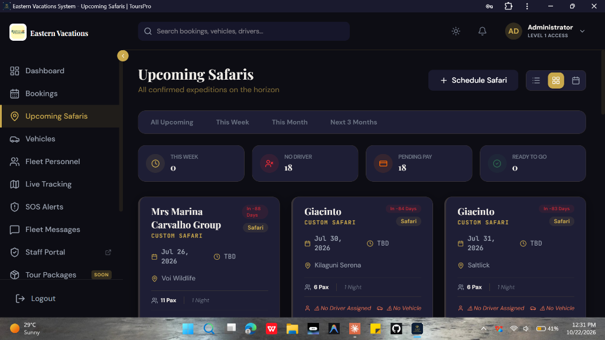
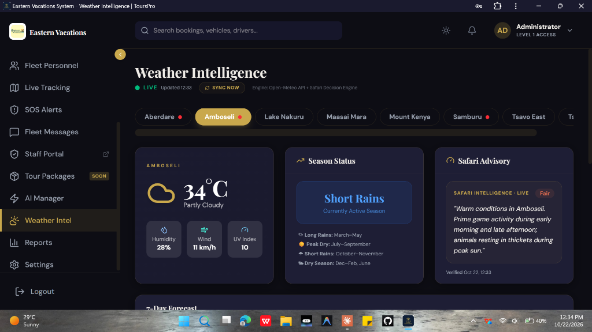
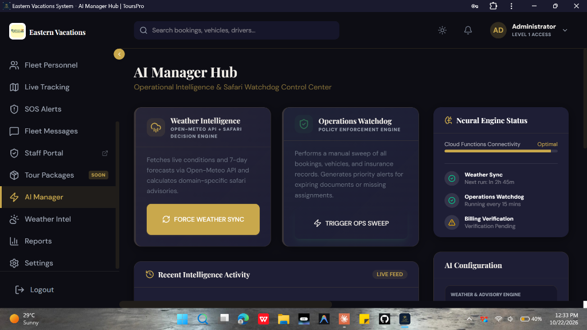
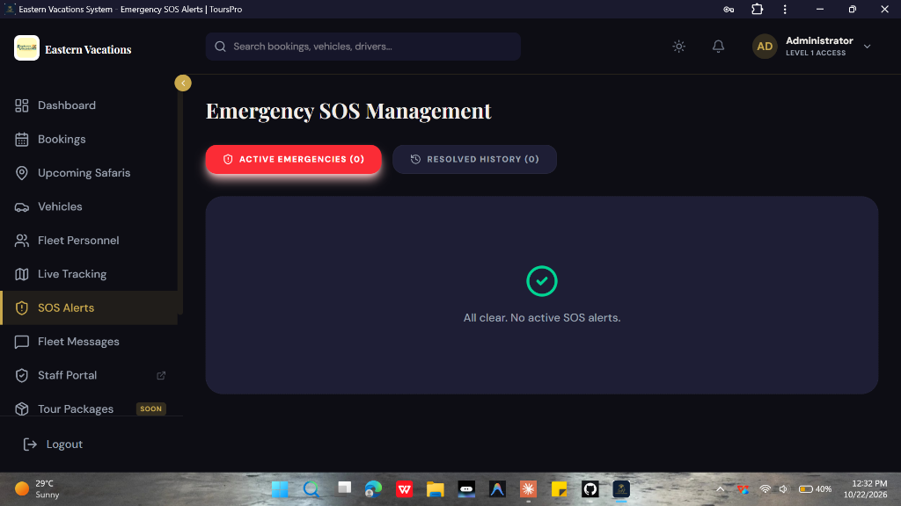
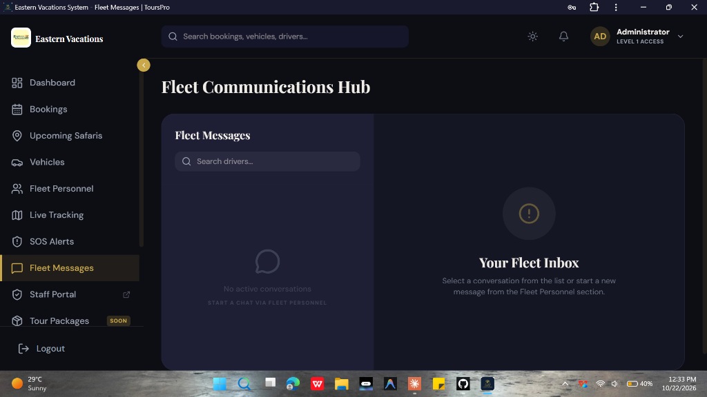
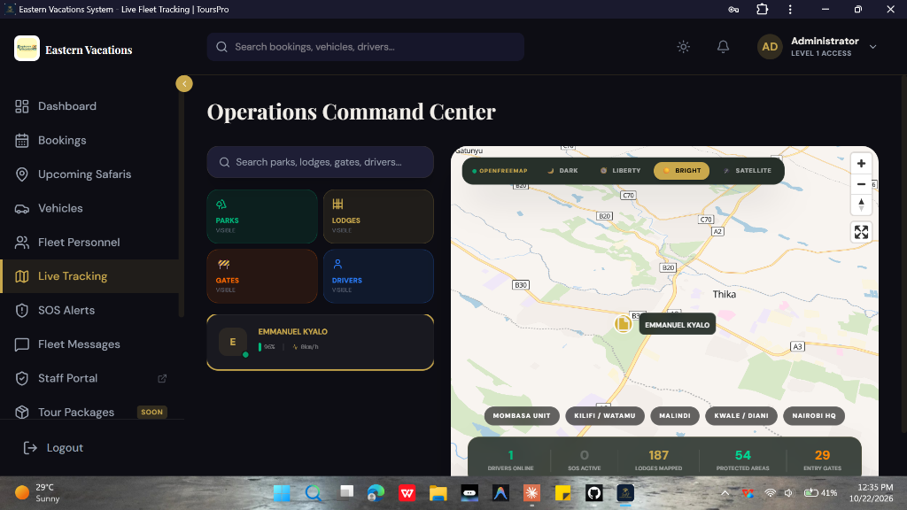

<p align="center">
  
</p>

# Axelo Safari Suite — Operations & Fleet Intelligence System

**Axelo Safari Suite** is a unified tour operations, fleet telematics, and field safety intelligence platform engineered specifically for safari operators, destination management companies (DMCs), and expedition providers across East Africa.

Built in close alignment with premier safari operators including Eastern Vacations, Axelo replaces fragmented spreadsheets, informal messaging chats, and lost paper manifests with a real-time, mission-critical operations command center connected directly to drivers in the field.

---

## 🌍 The Problem Tour Operators Face

Safari logistics are unlike standard transport operations. Safari companies coordinate high-value itineraries across expansive wilderness parks, unpredictable weather patterns, and harsh terrains with limited infrastructure:

1. **Logistics & Dispatch Blind Spots:**
   Operations controllers rely on phone calls or WhatsApp to track safari cruisers deep in vast national reserves, leaving dispatch blind to breakdowns, road closures, or guide delays.
2. **Pre-Departure Vulnerabilities:**
   Cruisers depart with unassigned 4x4 vehicles, unverified driver rosters, or uncollected client balances because reservations and garage dispatch operate in isolated silos.
3. **Severe Weather & Terrain Hazards:**
   Flash floods, river swell, and slick black-cotton soil can trap vehicles and disrupt game drives without localized, park-by-park environmental intelligence.
4. **Emergency Telemetry Vacuum:**
   When mechanical failures, wildlife hazards, or guest medical emergencies occur in remote conservancies, drivers lack an instant emergency channel that broadcasts precise GPS coordinates to the operations team.
5. **Vehicle Compliance & Maintenance Risks:**
   Lapses in PSV insurance, commercial inspection certificates, or routine 4x4 servicing lead to impounded cruisers, safety risks, and disrupted guest experiences.

---

## ⚡ How Axelo Solves It

Axelo Safari Suite bridges the central operations office with field vehicles and lodge crews, creating an end-to-end operational loop from booking creation to post-safari debrief.

```
┌────────────────────────────────────────────────────────────────────────┐
│                        AXELO ECOSYSTEM OVERVIEW                        │
├───────────────────────────────────┬────────────────────────────────────┤
│      CENTRAL COMMAND CENTER       │   AXELO DRIVERS COMPANION APP      │
│  (Head Office & Dispatch Team)    │     (Guides, Drivers & Porters)    │
│                                   │                                    │
│  • Reservation & Itinerary Engine │  • Biometric Facial Scan Check-In  │
│  • Live GPS Fleet Telemetry Map   │  • Live Guest Manifests & Rooming  │
│  • 10-Park Weather Intel & AI     │  • Digital Park & KWS Fee Logging  │
│  • Autonomous 7/3/1 Day Sweeps    │  • One-Touch Wilderness SOS Alert  │
│  • Insurance & Compliance Guard   │  • Porter & Airstrip Baggage Flow  │
└───────────────────────────────────┴────────────────────────────────────┘
```

---

## 📱 Includes Dedicated Companion App: "Axelo Drivers"

Axelo is not just a desktop dispatch dashboard—it ships with a dedicated mobile-first companion application (**Axelo Drivers**) designed specifically for safari driver-guides, expedition leaders, and field logistics crews.

### 1. 👤 Biometric Facial Scan Check-In
* **Driver Identity & Sobriety Verification:** Before initiating a tour or morning game drive, drivers perform a secure biometric face scan directly from the mobile app.
* **Pre-Trip Compliance Check:** Prevents unverified vehicle handovers and records exact driver check-in timestamps before guests board the cruiser.

### 2. 📋 Live Safari Manifests & Route Briefings
* **Real-time Guest Profiles:** Guides access interactive manifests displaying passenger names, passport numbers, rooming allocations, emergency contacts, and language preferences.
* **Special Needs & Dietary Tracking:** Highlights critical guest requirements (allergies, vegan/halal meal plans, mobility assistance) directly on the driver's device.
* **Turn-by-Turn Safari Stages:** Tracks safari legs from Nairobi or Mombasa transfers through lodge check-ins, game drive loops, and bush flight airstrip pickups.

### 3. 🎟️ Park Fees & Gate Clearance Tracking
* **KWS & Conservancy Receipts:** Drivers log Kenya Wildlife Service (KWS) smart cards, conservancy fee authorizations, and vehicle gate entry/exit receipts directly from the field.
* **Discrepancy Prevention:** Eliminates lost paper gate tickets and enables real-time reconciliation with head-office accounts.

### 4. 🚨 Instant Bush SOS & Emergency Protocol
* **One-Touch Field Distress Signal:** Dedicated emergency interface enabling drivers to instantly notify the central operations command center with high-precision GPS coordinates.
* **Categorized Incident Dispatch:** Classifies emergencies into *Mechanical Breakdown*, *Mud/River Recovery*, *Medical Emergency*, or *Security/Wildlife Encounter*.
* **Status Telemetry:** Drivers receive real-time confirmation when dispatch has acknowledged the alert and dispatched a recovery vehicle or ranger support.

### 5. 🧳 Porter & Lodge Logistics Management
* **Baggage Loaders & Camp Porters:** Dedicated portal for lodge porters and airport transfer teams to track luggage counts, tag allocations, and vehicle loading verification.

---

## 🖥️ Central Command Suite Features

### 1. 📅 Upcoming Safaris & Expedition Horizon
<p align="center">
  
</p>

* **Real-Time Departure Telemetry:** Live operations dashboard monitoring all confirmed upcoming safaris with high-visibility countdown indicators (`In -88 Days`, `In -84 Days`, etc.).
* **Pre-Trip Guardrails & Readiness Counters:** Instantly surfaces operational bottlenecks before departure:
  * **This Week Expeditions:** Immediate focus on cruisers departing in the next 7 days.
  * **Unassigned Driver Warnings:** Flags departures lacking certified driver-guide allocations.
  * **Pending Payment Guard:** Identifies uncollected client balances before vehicles leave the depot.
  * **Ready to Go Status:** Clear visual clearance for fully assigned, fully paid itineraries.
* **Flexible Dispatch Views:** Quickly toggle between Grid Card View, Compact Table List, and Itinerary Calendar views, with quick-filters for *This Week*, *This Month*, and *Next 3 Months*.

---

### 2. 🌦️ Park-Specific Weather Intelligence & Safari Advisories
<p align="center">
  
</p>

* **Live Environmental Tracking across 10 National Parks:**
  Dedicated real-time weather and 7-day forecasts for *Aberdare, Amboseli, Lake Nakuru, Maasai Mara, Meru, Mount Kenya, Nairobi National Park, Samburu, Tsavo East, and Tsavo West*.
* **Powered by [Open-Meteo](https://github.com/open-meteo/open-meteo):**
  High-accuracy, open-source meteorological engine delivering hyper-local temperature, relative humidity, wind speed, UV index, and precipitation forecasts with zero rate-limit key dependencies.
* **Rule-Based Safari Advisory Engine:**
  Translates live environmental telemetry into actionable operational recommendations:
  * *Trail & Terrain Intelligence:* Advises 4x4 diff-lock engagement and mud recovery gear when black-cotton soils turn slick.
  * *Vehicle Management:* Alerts drivers on pop-up roof management during sudden rain squalls or high dust gusts.
  * *Highland Comfort Alerts:* Recommends warm-attire guest advisories for chilly highland descents in Aberdare and Mount Kenya.
  * *Wildlife Photography Forecasts:* Identifies optimal predator portraiture windows during soft, diffused overcast light.

---

### 3. 🤖 Autonomous Operations Watchdog (AI Engine)
<p align="center">
  
</p>

* **Mission-Critical Watchdog Control Center:** Dedicated AI operations console managing autonomous audit routines, policy enforcement, and synchronization tasks.
* **Automated Departure Audits:** Continuous background sweeps monitor upcoming itineraries to prevent operational failure:
  * **7 Days to Departure:** Early equipment, vehicle readiness, and logistics audit.
  * **3 Days to Departure:** High-priority escalation flagging unassigned drivers, unallocated 4x4 cruisers, or outstanding client payments.
  * **24 Hours to Departure:** Final dispatch lock, preparing gate manifests and emergency contacts.
* **Real-Time Neural Engine Telemetry:**
  * Displays live health status of Firebase Cloud Functions connectivity.
  * Scheduled automatic weather synchronization every 3 hours with on-demand manual force sync.
  * 15-minute background sweeps auditing vehicle documentation and tour readiness.
* **Commercial Compliance Guard:** Automatically checks commercial PSV insurance and vehicle inspection validity, locking vehicles approaching compliance lapse.

---

### 4. 🚨 Central Emergency SOS Management
<p align="center">
  
</p>

* **Real-Time Incident Command:** Instant reception of distress signals triggered from the field by the Axelo Drivers companion app.
* **Active vs. Resolved Incident Triage:** Segregates high-urgency active incidents from historical recovery archives with detailed post-incident logs.
* **Field Coordinate Telemetry:** Pinpoints driver GPS coordinates in remote wilderness zones for rapid dispatch of backup cruisers, mechanic teams, or emergency ranger recovery.

---

### 5. 💬 Fleet Communications Hub
<p align="center">
  
</p>

* **Dedicated Dispatch-to-Driver Messaging:** Direct operational communications channel connecting head-office controllers with driver-guides in the field.
* **Centralized Fleet Inbox:** Organized conversation threads per driver and safari expedition, eliminating fragmented personal chat channels.
* **Audit-Proof Operational History:** Preserves official dispatch orders, route deviations, and road advisories in a centralized, searchable log.

---

### 6. 🗺️ Real-Time Fleet Tracking & Telematics (Operations Command Center)
<p align="center">
  
</p>

* **Interactive Expedition & Cruiser GIS Map:** Real-time GIS telematics interface powered by customizable map engines (*OpenFreeMap, Satellite, Dark, Liberty, and Bright*).
* **Multi-Layer Wilderness Infrastructure:** Granular layer toggles for operations controllers:
  * **187 Lodges & Camps Mapped:** Instant geographic reference for bush properties, tented camps, and airstrips across East Africa.
  * **54 Protected Wilderness Areas:** Explicit boundary tracking across National Parks, Game Reserves, and Community Conservancies.
  * **29 Park Entry & Transit Gates:** Monitored checkpoints ensuring timely gate clearance and accurate KWS fee logging.
* **Live Driver Telemetry & Battery Telemetry:** Real-time cruiser tracking displaying driver name, vehicle speed (`0 km/h`, transit speeds), mobile battery percentage (`96%`), and connection health.
* **Regional Sector Hubs:** Rapid focal switching between primary operating theaters: *Mombasa Unit, Kilifi / Watamu, Malindi, Kwale / Diani, and Nairobi HQ*.
* **Emergency Triage Integration:** Instant red-alert visual banner overlay whenever an active wilderness SOS is triggered in the field.

---

### 7. 📋 Comprehensive Booking & Voucher Engine
* **Full Safari Lifecycle Tracking:** From inquiry and quotation to confirmed booking, active safari, and post-trip invoicing.
* **Automated Client Vouchers:** Instant generation of professional safari vouchers, hotel rooming confirmations, and itinerary printouts.
* **Multi-Currency Payment Ledger:** Integrated tracking of deposits, balance dues, and payment methods.

---

### 8. 🔐 Enterprise Role-Based Access Control (RBAC)
* **Multi-Tier Authorization:** Strictly separates Administrator control, Reservation Agent intake, and Driver field permissions.
* **Secure Cloud Data Rules:** Real-time database protection ensuring confidential operational, financial, and client data remains strictly guarded.

---

## 🏁 Getting Started

### Prerequisites
* Modern web browser (Chrome, Edge, Safari, Firefox)
* Access credentials provided by your safari company administrator

### Accessing the Suite
1. **Office Operations Portal:** Log in with your corporate credentials to access the central booking, fleet tracking, and weather intelligence dashboards.
2. **Driver Companion App:** Open the Axelo Drivers app on your mobile device, perform your biometric face check-in, and review your assigned trip manifest.

---

## 🛡️ Operational Reliability & Security

* **Built for Remote Africa:** Offline-ready progressive application architecture ensures drivers and lodge teams retain access to passenger manifests even in low-connectivity bush zones.
* **Audit Trail:** Append-only operational event logs record vehicle movements, SOS incidents, and manifest updates for full transparency and guest safety compliance.

---

## 📜 License & Ownership

Proprietary enterprise software developed by **Axelo Software** for **Eastern Vacations System**. All rights reserved.
